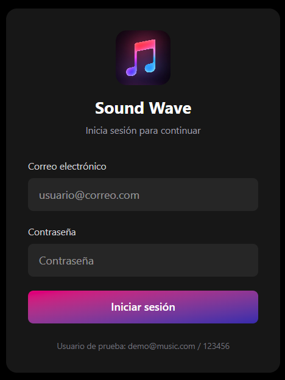
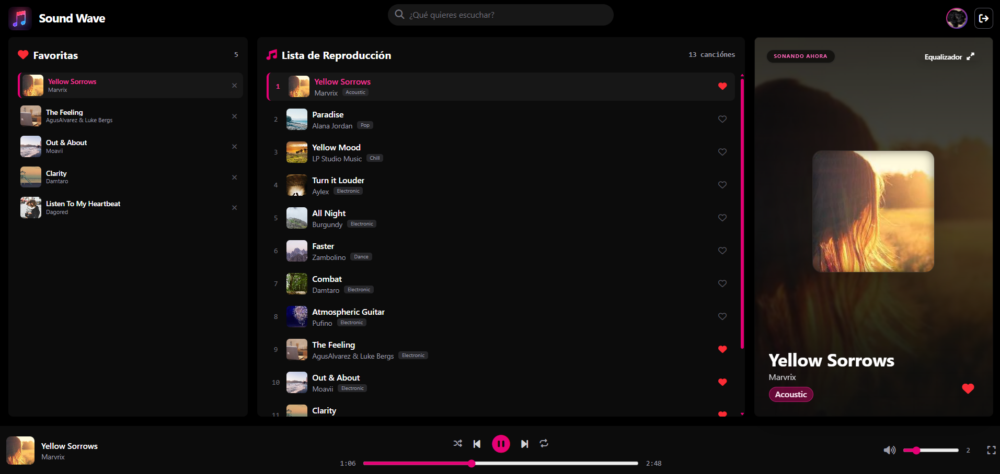
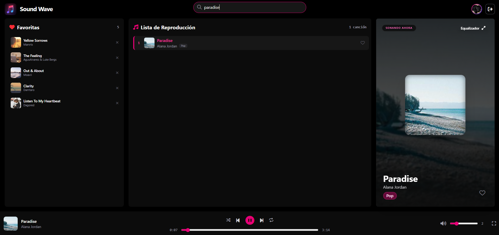
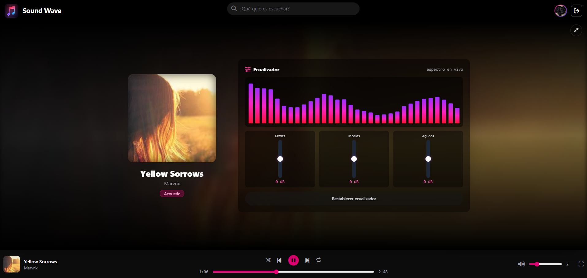

# Sound Wave

Aplicación web frontend para reproducir música desde el navegador. El proyecto incluye una pantalla de inicio de sesión de demostración y una interfaz de reproducción con playlist, favoritos, búsqueda, controles de audio, ecualizador visual y atajos de teclado.

## Índice

- [Características](#características)
- [Capturas de demostración](#capturas-de-demostración)
- [Tecnologías](#tecnologías)
- [Estructura del proyecto](#estructura-del-proyecto)
- [Puesta en marcha](#puesta-en-marcha)
- [Inicio de sesión](#inicio-de-sesión)
- [Uso del reproductor](#uso-del-reproductor)
- [Arquitectura JavaScript](#arquitectura-javascript)
- [Persistencia de datos](#persistencia-de-datos)
- [Configuración de canciones](#configuración-de-canciones)
- [Solución de problemas](#solución-de-problemas)

## Características

- Inicio de sesión de demostración.
- Protección de la página del reproductor mediante `sessionStorage`.
- Reproducción de archivos MP3 con Howler.js.
- Play, pausa, canción anterior y siguiente.
- Barra de progreso y búsqueda temporal.
- Control de volumen y silencio.
- Modos aleatorio y repetición.
- Búsqueda de canciones por título, artista o género.
- Lista de canciones favoritas.
- Vista ampliada con información de la canción.
- Visualizador animado en Canvas.
- Controles visuales de ecualizador para graves, medios y agudos.
- Pantalla completa.
- Atajos de teclado:
  - `Espacio`: reproducir o pausar.
  - `Flecha derecha`: avanzar cinco segundos.
  - `Flecha izquierda`: retroceder cinco segundos.

## Demo

### Inicio de sesión



### Reproductor



### Búsqueda de canciones



### Ecualizador y visualizador



## Tecnologías

- HTML5.
- CSS3.
- JavaScript moderno con módulos ES.
- Tailwind CSS mediante CDN.
- Font Awesome mediante CDN.
- Howler.js mediante CDN.
- Canvas 2D para el visualizador.
- `localStorage` y `sessionStorage` del navegador.

No hay un `package.json`, un proceso de compilación ni un backend. La aplicación se ejecuta como una página estática servida por un servidor local.

## Estructura del proyecto

```text
reproductor-musical/
├── index.html
├── Readme.md
├── .vscode/
│   └── settings.json
└── src/
    ├── assets/
    │   ├── demos/
    │   │   ├── equalizer-demo.png
    │   │   ├── login-demo.png
    │   │   ├── player-demo.png
    │   │   └── search-demo.png
    │   └── img/
    │       └── note.jpg
    ├── data/
    │   └── music.json
    ├── js/
    │   ├── app.js
    │   ├── auth/
    │   │   ├── auth.js
    │   │   └── player-auth.js
    │   └── modules/
    │       ├── favorites.js
    │       ├── player.js
    │       ├── playlist.js
    │       ├── shortcuts.js
    │       ├── ui.js
    │       └── visualizer.js
    ├── music/
    │   └── archivos MP3
    ├── pages/
    │   └── player.html
    └── styles/
        └── style.css
```

### Páginas principales

- `index.html`: formulario de inicio de sesión.
- `src/pages/player.html`: interfaz del reproductor.

### Punto de entrada de cada página

El login carga:

```html
<script type="module" src="./src/js/auth/auth.js"></script>
```

El reproductor carga el control de sesión y la aplicación:

```html
<script type="module" src="../js/auth/player-auth.js"></script>
<script src="https://cdn.jsdelivr.net/npm/howler@2.2.4/dist/howler.min.js"></script>
<script type="module" src="../js/app.js"></script>
```

## Puesta en marcha

### Requisito

La aplicación debe abrirse mediante un servidor web local. No se recomienda abrir `index.html` directamente con `file:///`, porque los módulos JavaScript y las peticiones `fetch()` pueden ser bloqueados por el navegador.

### Opción 1: Live Server en VS Code

1. Instala la extensión **Live Server**.
2. Abre la carpeta raíz del proyecto en VS Code.
3. Haz clic derecho sobre `index.html`.
4. Selecciona **Open with Live Server**.
5. La configuración del proyecto usa el puerto `5501`:

   ```text
   http://127.0.0.1:5501/
   ```

### Opción 2: otro servidor estático

Configura el servidor para que la raíz pública sea la carpeta del proyecto y abre:

```text
/index.html
```

La ruta de `music.json` usada por `playlist.js` es:

```text
/src/data/music.json
```

## Inicio de sesión

El login actual es únicamente una validación frontend con credenciales fijas para demostración:

```text
Correo:      demo@music.com
Contraseña:  123456
```

Cuando las credenciales son correctas, `auth.js` guarda el usuario en:

```text
sessionStorage["music_user"]
```

y redirige a:

```text
/src/pages/player.html
```

`player-auth.js` comprueba que exista esa sesión. Si no existe, redirige al usuario de vuelta a `index.html`. El botón **Cerrar sesión** elimina la sesión y vuelve al login.

## Uso del reproductor

### Playlist

Las canciones se cargan desde `src/data/music.json`. Al seleccionar una canción se actualizan:

- La portada.
- El título.
- El artista.
- El género.
- La barra inferior.
- El estado de reproducción.

### Favoritos

El botón del corazón añade o elimina una canción de favoritos. Los IDs de las canciones se guardan en:

```text
localStorage["music_player_favorites"]
```

Los favoritos se mantienen aunque se cierre el navegador, salvo que se borre el almacenamiento del sitio.

### Búsqueda

El buscador filtra en tiempo real por:

- Título.
- Artista.
- Género.

El botón con el icono de casa limpia el filtro actual.

### Ecualizador y visualizador

La vista ampliada contiene un visualizador Canvas de 32 barras. Los controles de graves, medios y agudos modifican la animación visual. Actualmente no aplican filtros de audio reales al sonido.

## Arquitectura JavaScript

### `app.js`

Es el orquestador principal del reproductor. Inicializa el motor de audio, carga la playlist, configura los eventos y conecta los módulos entre sí.

### `modules/player.js`

Encapsula Howler.js y gestiona:

- Carga de canciones.
- Reproducción y pausa.
- Tiempo actual y duración.
- Volumen y silencio.
- Repetición y reproducción aleatoria.

### `modules/playlist.js`

Carga el catálogo JSON y gestiona el índice actual, la navegación y el filtrado.

### `modules/ui.js`

Centraliza las referencias al DOM, actualiza la canción actual, renderiza la playlist y renderiza favoritos.

### `modules/favorites.js`

Lee y guarda los IDs de favoritos en `localStorage`.

### `modules/visualizer.js`

Dibuja el visualizador en Canvas y actualiza las etiquetas de las bandas del ecualizador.

### `modules/shortcuts.js`

Registra los atajos de teclado sin interferir cuando el usuario escribe en un campo de texto.

### `auth/auth.js`

Valida las credenciales de demostración, crea la sesión y redirige al reproductor.

### `auth/player-auth.js`

Protege la página del reproductor y gestiona el cierre de sesión.

## Persistencia de datos

La aplicación no utiliza una base de datos.

| Dato | Almacenamiento | Duración |
|---|---|---|
| Usuario autenticado | `sessionStorage` | Hasta cerrar la sesión del navegador o ejecutar logout |
| Canciones favoritas | `localStorage` | Persistente en el navegador |
| Playlist y canción actual | Memoria JavaScript | Se pierde al recargar |

## Configuración de canciones

Cada canción del archivo `src/data/music.json` debe tener, como mínimo, esta estructura:

```json
{
    "id": 1,
    "title": "Nombre de la canción",
    "artist": "Artista",
    "genre": "Género",
    "cover": "/src/assets/img/note.jpg",
    "src": "/src/music/song1.mp3"
}
```

Los archivos referenciados en `src` deben existir dentro de `src/music/`. Las rutas absolutas desde la raíz pública, como `/src/music/song1.mp3`, evitan problemas al abrir el reproductor desde `src/pages/player.html`.

## Solución de problemas

### El reproductor aparece vacío

Comprueba lo siguiente:

1. La página se está sirviendo mediante Live Server u otro servidor local.
2. La petición a `/src/data/music.json` devuelve código `200`.
3. El navegador no muestra errores de módulos JavaScript en la consola.
4. `music.json` contiene un array válido.

### `player-auth.js` devuelve un error 404

El archivo está dentro de `src/js/auth/`, por lo que la referencia correcta desde `src/pages/player.html` es:

```html
<script type="module" src="../js/auth/player-auth.js"></script>
```

No debe usarse `../js/player-auth.js`, porque esa ubicación no existe.

### Las canciones no se reproducen

Comprueba que las rutas del JSON comiencen por `/src/music/`:

```json
"src": "/src/music/song1.mp3"
```

También verifica que el archivo MP3 exista y que la pestaña **Network** del navegador no muestre un error `404`.

### El usuario vuelve al login al abrir el reproductor

Es el comportamiento esperado si no existe `music_user` en `sessionStorage`. Inicia sesión desde `index.html` antes de acceder a `src/pages/player.html`.

### No se cargan las imágenes

Comprueba que las imágenes existan y que las rutas sean accesibles desde la raíz del servidor, por ejemplo:

```text
/src/assets/img/note.jpg
```
